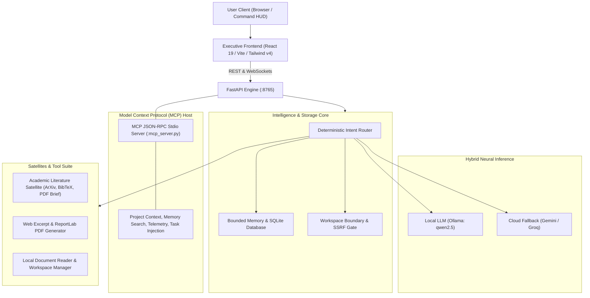

# Yomi — Executive Intelligence & Academic Research Assistant

Yomi is an extensible executive AI assistant and local-first research platform. Built for speed, privacy, and deep tool integration, Yomi pairs an asynchronous Python FastAPI backend with a modern React executive dashboard styled in the **Bklit UI** design system.

---

## Tech Stack

| Layer | Technologies |
| :--- | :--- |
| **Frontend** | React 19, Vite, Tailwind CSS v4, Lucide Icons |
| **Design System** | Bklit UI Specification (Dark Obsidian, OKLCH scales, hairline frames) |
| **Backend API** | FastAPI, Uvicorn (ASGI), WebSockets, Pydantic |
| **Language Models** | Hybrid Orchestration: Local Offline (Ollama / Qwen2.5) + Cloud (Gemini, Groq) |
| **Protocol Integration** | Model Context Protocol (MCP) JSON-RPC 2.0 STDIO Server |
| **State & Memory** | SQLite with Foreign Keys and WAL mode |
| **Execution Security** | Opt-in developer code runner (disabled by default, returns HTTP 403) |
| **Network Boundaries** | Strict SSRF defense with DNS resolution and redirect hop validation |

---

## System Architecture



---

## Core Capabilities

### 1. Hybrid Neural Intelligence & Intent Routing
* **Deterministic Fast-Path:** Instant parsing for tasks, literature queries, hardware telemetry, and document inspection without unnecessary LLM latency.
* **Local-First & Cloud Fallback:** Integrates local offline inference via Ollama (`qwen2.5:7b`), with graceful fallback to Gemini or Groq when configured.

### 2. Academic Literature Satellite
* **ArXiv Search & Extraction:** Live queries to ArXiv API with metadata parsing (authors, year, abstract, repository URL).
* **Reference Brief Compilation:** Generates structured executive research brief PDFs using ReportLab with full Unicode, Japanese (`HeiseiMin-W3`, `HeiseiKakuGo-W5`), and Greek/mathematical symbol support.
* **BibTeX Export:** Automatic formatting of standard `@article{...}` entries with clean citation keys.

### 3. Model Context Protocol (MCP) Server
* **Standard JSON-RPC Host:** Exposes `backend/mcp_server.py` over stdio with verified `initialize`, `tools/list`, and `tools/call` handling.
* **Registered Tools:** Provides project context inspection, persistent memory search, host telemetry, and task injection.

### 4. Security & Isolation Controls
* **Workspace Boundary Containment:** Shared tools validate file paths against `WORKSPACE_ROOT` to prevent path traversal.
* **SSRF Protection:** Web fetching strictly validates IP addresses against private, loopback, link-local, and cloud metadata ranges after DNS resolution and on every redirect hop.
* **Default-Disabled Execution:** Arbitrary code execution is gated behind `YOMI_ENABLE_DEV_RUNNER=true` in `.env`.
* **Restricted CORS:** Loopback origins allowed by default.

### 5. High-Craft Bklit Executive Interface
* **Bklit Design Tokens:** Dark obsidian styling (`#09090b` / `#0e0e11`) with hairline frames (`.bklit-frame`), OKLCH chart tokens (`--chart-1` to `--chart-5`), and responsive layout.
* **Honest Data States:** Metrics display "Not measured" or "Not verified" when unrecorded; research satellite displays distinct loading, empty, and failure states.
* **Real-Time Task Synchronization:** Synchronizes task modifications directly with SQLite storage across chat and UI interactions.

---

## Repository Structure

```text
Yomi/
├── backend/
│   ├── config.py              # Centralized configuration, SSRF & workspace validation
│   ├── brain.py               # Intent router and multi-step tool dispatch
│   ├── llm_client.py          # LLM client (Ollama, Gemini, Groq) with offline handling
│   ├── memory.py              # Persistent SQLite storage and chat history
│   ├── database.py            # SQLite schema migrations and connection pool
│   ├── mcp_server.py          # Model Context Protocol (MCP) JSON-RPC stdio server
│   ├── mcp_connector.py       # CiteX HTTP REST client bridge
│   ├── main.py                # FastAPI server (REST endpoints & WebSockets)
│   ├── requirements.txt       # Python package dependencies
│   └── tools/
│       ├── academic_researcher.py # ArXiv literature satellite & PDF brief generator
│       ├── paper_reader.py    # Local PDF inspector with workspace containment
│       ├── web_summarizer.py  # Web content extractor & summary PDF generator
│       ├── web_intelligence.py# Live DuckDuckGo organic search & markdown scraper
│       ├── code_sandbox.py    # Opt-in developer code runner (disabled by default)
│       └── workspace_manager.py# Workspace file lister and proposal stats
├── frontend/
│   ├── src/
│   │   ├── App.tsx            # Main executive HUD view controller
│   │   ├── api.ts             # Typed REST API client
│   │   ├── index.css          # Bklit UI design tokens, frame architecture & styles
│   │   └── main.tsx           # React entry point
│   ├── index.html             # HTML shell with dark theme and Geist typography
│   └── package.json           # Frontend dependencies
├── tests/
│   ├── test_audit_repairs.py  # Unit test suite for security and backend integrity
│   └── test_pdf_unicode.py    # Unicode PDF compilation & image rendering test
├── run_yomi.bat               # Background service launcher
├── mockup.html                # Standalone Bklit design reference
└── README.md                  # System documentation
```

---

## Quickstart Guide

### 1. Prerequisites
* **Python 3.10+** (Python 3.11 or 3.12 recommended)
* **Node.js 18+** (Node.js 20+ LTS recommended)
* *(Optional)* [Ollama](https://ollama.ai) with `qwen2.5:7b` for local offline inference

### 2. Setup
```bash
# Backend dependencies
pip install -r backend/requirements.txt

# Frontend dependencies
cd frontend
npm install
```

### 3. Running Yomi
Launch both services with the launcher script:
```cmd
.\run_yomi.bat
```
Or start manually:
```bash
# Terminal 1: Backend
python -m uvicorn backend.main:app --host 127.0.0.1 --port 8765

# Terminal 2: Frontend
cd frontend
npm run dev -- --host 127.0.0.1 --port 5173
```
Open `http://127.0.0.1:5173` in your browser.

## Local data

Yomi keeps records in the current user’s `.yomi` folder. Set `YOMI_WORKSPACE_ROOT` in your local `.env` to choose another private directory outside the checkout. New installations start with empty task and chat databases. The admissions dashboard reads `admissions.json` from this folder. For an existing installation, back up the old backend/yomi.db as tasks.db and the old root yomi.db as memory.db using SQLite backup before switching. Copy existing exports into exports/ under the new folder.
