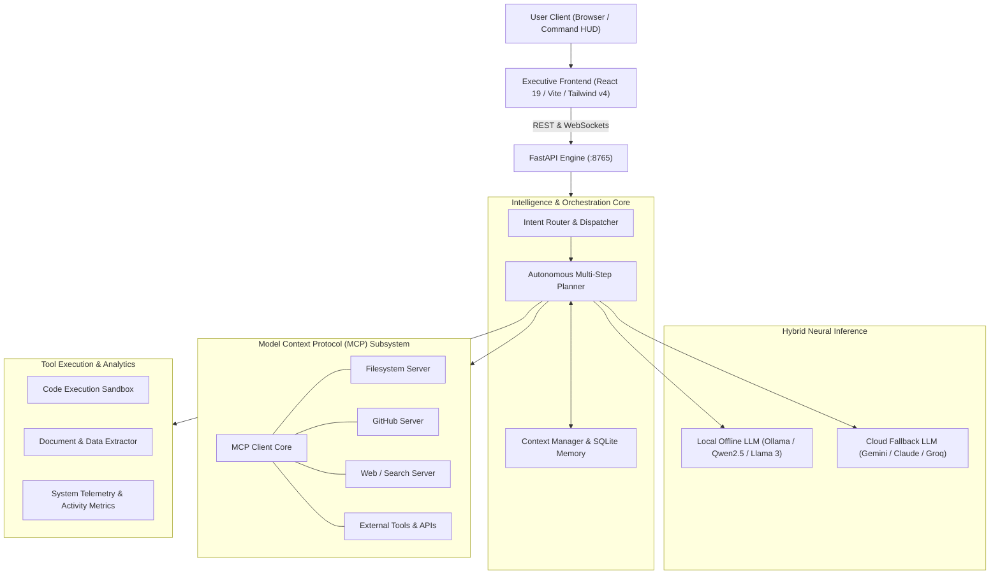

# Yomi — Autonomous Executive AI & Local-First Intelligence Engine

Yomi is an extensible, autonomous executive AI assistant and local-first personal operating system. Built for speed, privacy, and deep tool integration, Yomi pairs a high-performance Python orchestration backend with a modern React executive dashboard styled in the **Bklit UI** design system.

---

## Tech Stack

| Layer | Technologies |
| :--- | :--- |
| **Frontend** | React 19, Vite, Tailwind CSS v4, Lucide Icons |
| **Design System** | Bklit UI Specification (Dark Obsidian, OKLCH scales, hairline frames) |
| **Backend API** | FastAPI, Uvicorn (ASGI), WebSockets, Pydantic |
| **Language Models** | Hybrid Orchestration: Local (Ollama / Qwen2.5) + Cloud (Google Gemini, Anthropic, Groq) |
| **Protocol Integration** | Model Context Protocol (MCP) Client SDK |
| **State & Memory** | SQLite, Local JSON context store |
| **Execution Sandbox** | Subprocess worker sandbox, safe Python evaluator |

---

## System Architecture



---

## Core Capabilities

### 1. Hybrid Neural Intelligence Core
* **Local-First & Cloud-Augmented:** Seamlessly switches between local offline inference (via Ollama) for privacy and zero-latency queries, and high-capability cloud LLMs (Gemini, Claude, Groq) for complex multi-modal analysis.
* **Intent Routing Engine:** Deterministic pre-classifier parses user instructions, identifies parameter requirements, and selects optimal models or tools without burning unnecessary inference cycles.

### 2. Persistent Memory & State Retention
* **Local SQLite Store:** Persistent indexing of conversation threads, user preferences, past project contexts, and long-term memory.
* **Session Restoration:** Automatically recovers working context, ongoing task chains, and environmental variables between application restarts.

### 3. Model Context Protocol (MCP) Integration
* **Universal Tool Extensibility:** Built-in MCP client communicates natively with standard MCP server implementations.
* **Dynamic Server Management:** Connect to filesystem tools, repository managers, search providers, and custom microservices.
* **Encrypted Token Management:** Masked API token storage with granular permissions and instant connectivity health verification.

### 4. Autonomous Tool Execution & File Inspection
* **Isolated Execution Sandbox:** Safely execute Python scripts, perform mathematical operations, and validate algorithms in an isolated sub-process sandbox.
* **Document & Data Extraction:** Deep text, markdown, and document parsing for contextual synthesis and literature review.
* **System Telemetry:** Real-time logging of latency metrics, query token counts, and subsystem operational statuses.

### 5. High-Craft Bklit Executive Interface
* **Zero Clutter:** Ultra-minimalist dark obsidian theme (`#09090b` / `#0e0e11`) with hairline precision borders (`rgba(255, 255, 255, 0.08)`) and high-density information display.
* **Live System Metrics:** Interactive SVG activity telemetry, real-time response waveforms, and categorized operational gauges.
* **Modular Multi-View Hub:** Switch between the central command HUD, document and data repositories, learning engines, and external connection managers.
* **Docked Controller:** Non-intrusive, minimizable micro-pill controller for task tracking that leaves working surfaces unobstructed.

---

## Repository Structure

```text
Yomi/
├── backend/
│   ├── brain.py               # Intent routing and LLM multi-step orchestration
│   ├── llm_client.py          # Provider client (Ollama, Gemini, Anthropic, Groq)
│   ├── memory.py              # Persistent SQLite storage and context recall
│   ├── database.py            # SQLite schema migrations and connection pool
│   ├── mcp_connector.py       # Model Context Protocol (MCP) client bridge
│   ├── mcp_servers.json       # MCP server endpoints and runtime configurations
│   ├── main.py                # FastAPI server (REST endpoints & WebSockets)
│   ├── requirements.txt       # Python package dependencies
│   └── tools/
│       ├── web_intelligence.py # Web search and article scrapers
│       ├── paper_reader.py    # Local document reader and text extraction
│       └── code_sandbox.py    # Isolated script execution environment
├── frontend/
│   ├── src/
│   │   ├── App.tsx            # Main application layout and view controller
│   │   ├── index.css          # Bklit UI design tokens, frame architecture, and styling
│   │   └── main.tsx           # React entry point
│   ├── public/
│   │   └── favicon.svg        # Cyber-Kamon vector brandmark
│   ├── package.json           # Frontend dependencies (React, Vite, Tailwind v4, Lucide)
│   ├── vite.config.ts         # Vite build configuration
│   └── index.html             # HTML entry shell
├── install_dependencies.bat   # Automated setup script
├── run_yomi.bat               # Background service launcher
└── README.md                  # System documentation
```

---

## Quickstart Guide

### 1. Prerequisites
* **Python 3.10+** (Python 3.11 or 3.12 recommended)
* **Node.js 18+** (Node.js 20+ LTS recommended)
* *(Optional)* [Ollama](https://ollama.ai) installed with `qwen2.5:7b` (or preferred model) for offline capability

### 2. Installation
Run the automated installer:
```cmd
.\install_dependencies.bat
```

Or install dependencies manually:
```bash
# Backend dependencies
pip install -r backend/requirements.txt

# Frontend dependencies
cd frontend
npm install
```

### 3. Configuration
Create a `.env` file in the project root to configure optional cloud providers:
```env
# Cloud Model API Keys (Optional - Local Ollama is used by default)
GEMINI_API_KEY=your_gemini_key_here
GROQ_API_KEY=your_groq_key_here
ANTHROPIC_API_KEY=your_anthropic_key_here

# Backend Network Configuration
YOMI_HOST=127.0.0.1
YOMI_PORT=8765
```

### 4. Running Yomi
Launch both backend and frontend services simultaneously:
```cmd
.\run_yomi.bat
```

Or run each service individually:
```bash
# Terminal 1: Backend API (port 8765)
python -m uvicorn backend.main:app --host 127.0.0.1 --port 8765

# Terminal 2: Frontend Dashboard (port 5173)
cd frontend
npm run dev -- --host 127.0.0.1 --port 5173
```

Open your browser to `http://127.0.0.1:5173`.

---

## License
Distributed under the **MIT License**.
