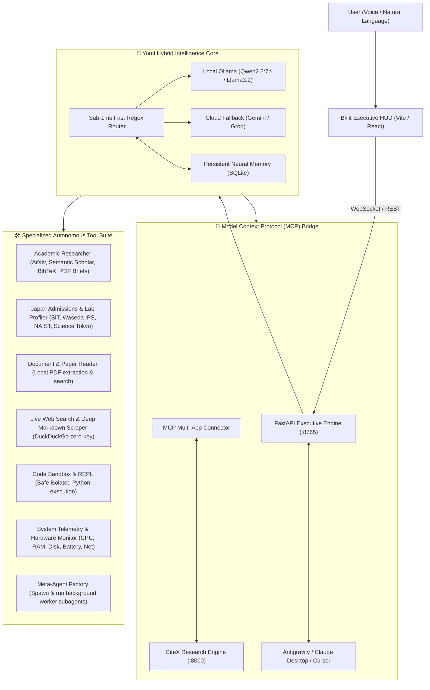

# ⚡ YOMI 2.0 — Executive AI Assistant & Research OS

> **Yomi OS 2.0** is an autonomous executive AI assistant, sovereign research chief of staff, and multi-domain orchestrator built with an ultra-minimalist, high-density **Bklit UI** design system ([bklit.com](https://bklit.com)), hardware telemetry, sub-millisecond intent routing, Model Context Protocol (MCP) bridges, and deep academic synthesis capabilities.

<p align="center">
  
  
  
  
  
  
</p>

---

## 🏛️ System Architecture



---

## ⚡ Core Features & Tool Matrix

### 1. 🎛️ Bklit Monochromatic Executive HUD
* Built strictly to the **Bklit UI Design Specification** ([bklit.com](https://bklit.com)).
* Canvas: Zinc-950 (`#09090b`), Hairline Borders (`1px solid rgba(255, 255, 255, 0.08)`), subtle hover elevation (`translateY(-2px)`).
* 4 Segmented Primary Hubs:
  1. `⚡ Intelligence HUD` — Live conversational feed, floating dictation capsule, quick-action chips.
  2. `🔬 Academic Radar` — ArXiv literature synthesis, BibTeX generator, PDF download cards.
  3. `⛩️ Roadmaps & Matrix` — Life domains, milestone trackers, priority execution matrix (`P1`, `P2`, `P3`).
  4. `🤖 Sub-Agents` — Meta-Agent spawner, background workers, 1-click execution.

### 2. 🔌 Model Context Protocol (MCP) & CiteX Bridge
* Native MCP Connector allowing Yomi to act as an MCP host and bridge external AI applications:
  * **CiteX Autonomous Research Engine:** Multi-source literature reviews (OpenAlex, Zenodo, ArXiv) and automatic IEEE LaTeX / PDF compilation.
  * Connect external MCP tools or start CiteX background service via voice: *"launch citex"* or *"ask citex to research self-adaptive systems"*.
  * Configuration in `backend/mcp_servers.json`.

### 3. ⛩️ Japan Graduate Admissions & Lab Fit Profiler
* Built-in intelligence for Japanese universities and faculty:
  * **Shibaura Institute of Technology (SIT):** Prof. Hiroaki Fukuda (Export control, pre-consultation, TAO).
  * **Waseda University (IPS):** Prof. Shigeru Fujimura (AY2027 application window: Dec 7–18, 2026).
  * **NAIST:** Prof. Michiko Inoue (Pre-screening deadline: Dec 8, 2026).
  * **Institute of Science Tokyo:** Prof. Kenji Tei & Prof. Xavier Défago (IGP-C window: Jan 2027).
  * **Ritsumeikan University:** FREX Space & Earth System Science Masterclass.
* **Academic Email Drafter:** Generates respectful, high-register inquiry and follow-up emails according to Japanese institutional conventions.
* **Thematic Fit Matcher:** Evaluates overlap between proposal keywords and prospective advisor publications.

### 4. 🔬 Academic Research Satellite & PDF Brief Generator
* Direct ArXiv and Semantic Scholar integration.
* Automatically compiles publication-grade monochrome PDF research briefs using ReportLab with one-click browser download.
* Generates formatted BibTeX citations.

### 5. 🌐 Sovereign Web Intelligence & Local PDF Reader
* **Live Zero-Key Web Search:** Real-time search via DuckDuckGo HTML parser—no API keys required.
* **Deep Page Reader:** Strips ads, scripts, and navigation to extract clean research Markdown notes.
* **Local Paper Reader:** Inspects local `.pdf` files, extracts page snippets, abstracts, and table contents via `pypdf`.

### 6. 💻 Python Code Sandbox & REPL
* Runs mathematical calculations, distributed consensus equations ($3f + 1 \le n$), and algorithmic simulations in an isolated subprocess with timeout protection.

### 7. 🎙️ Edge Neural Voice Engine
* Zero-VRAM neural speech synthesis powered by Microsoft `edge-tts` with W3C SSML breath-cadence pacing (400ms sentence pauses, 200ms comma pauses).

---

## 📁 Repository Structure

```text
YomiOS/
├── backend/
│   ├── brain.py               # Sub-1ms regex router + hybrid LLM orchestrator
│   ├── llm_client.py          # Unified multi-provider (Ollama / Gemini / Groq)
│   ├── memory.py              # Persistent SQLite memory & user profile recall
│   ├── database.py            # SQLite schema for domains, projects, tasks, logs
│   ├── mcp_connector.py       # MCP bridge & CiteX connector
│   ├── mcp_servers.json       # Registered MCP server definitions
│   ├── meta_agent_factory.py  # Spawns & runs sandboxed subagents
│   ├── voice_engine.py        # Edge-TTS neural speech engine
│   ├── main.py                # FastAPI REST & WebSocket server
│   ├── requirements.txt       # Python dependencies
│   └── tools/
│       ├── academic_researcher.py  # ArXiv, Semantic Scholar, ReportLab PDF
│       ├── admissions_engine.py    # University trackers, lab matcher, email drafter
│       ├── paper_reader.py         # Local PDF inspection & search
│       ├── web_intelligence.py     # Live DDG search & clean scraper
│       ├── web_summarizer.py       # Webpage to PDF briefing exporter
│       ├── code_sandbox.py         # Isolated Python execution runner
│       ├── workspace_manager.py    # Notes, file scanner, proposal statistics
│       └── os_control.py           # Real-time hardware telemetry & app launcher
├── frontend/
│   ├── src/
│   │   ├── App.tsx            # Bklit UI HUD, 4 segmented hubs, audio player
│   │   ├── index.css          # Tailwind CSS + Bklit dark monochromatic styles
│   │   └── main.tsx           # React entry point
│   ├── package.json
│   ├── vite.config.ts
│   └── tailwind.config.js
├── install_dependencies.bat   # 1-click Windows dependency setup
├── run_yomi.bat               # 1-click launcher for backend + frontend
├── mcp_config.json            # MCP server configuration for IDEs
└── README.md
```

---

## 🚀 Quickstart Guide

### 1. Prerequisites
- **Python 3.10+** (Python 3.11–3.14 verified)
- **Node.js 18+**
- *(Optional)* [Ollama](https://ollama.ai) with `qwen2.5:7b` for offline LLM reasoning

### 2. Installation
Run the automated installer:
```bash
.\install_dependencies.bat
```
Or manually:
```bash
pip install -r backend/requirements.txt
cd frontend && npm install
```

### 3. Launching Yomi OS
Double click `run_yomi.bat` or run:
```bash
# Terminal 1: Backend
uvicorn backend.main:app --port 8765 --reload

# Terminal 2: Frontend
cd frontend && npm run dev
```

Open `http://localhost:5173` in your browser.

---

## 📜 License
Distributed under the **MIT License**.
