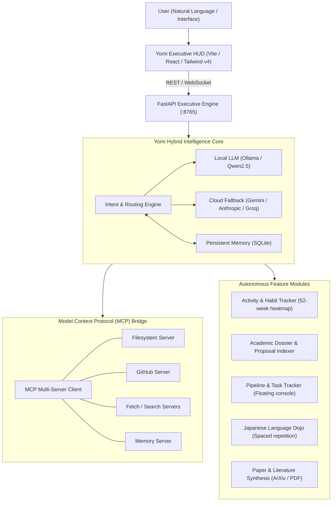

# Yomi — Executive Intelligence & Personal Operating System

Yomi is an autonomous personal AI executive system designed with the ultra-minimalist, high-density **Bklit UI** design system, local-first neural memory, sub-millisecond intent routing, Model Context Protocol (MCP) integrations, and specialized academic research workflows.

---

## System Architecture



---

## Core Capabilities

### 1. Bklit Minimalist Executive Interface
* Built strictly to the **Bklit UI Design Specification** with dark obsidian surfaces (`#09090b` / `#0e0e11`), hairline borders (`rgba(255, 255, 255, 0.08)`), and precision typography.
* Integrated custom OKLCH color scale with signature rose/coral accenting (`oklch(0.756 0.211 0)`) and Bklit 5-step sequential heatmap scales (`--chart-scale-01` through `--chart-scale-05`).
* Custom hairline scrollbars (`.card-scroll`) and zero emoji clutter.

### 2. 52-Week Habit & Research Heatmap
* Year-long activity and habit tracker with animated squircle cells, active streak monitoring, and dynamic hover metrics.
* Context-filtered views for multiple active workflows (Dojo drills, engineering, research synthesis, applications).

### 3. Intelligence HUD & Executive Neural Console
* Unified command console with conversational AI integration backed by local Ollama (`qwen2.5:7b`) and cloud fallbacks.
* Executive velocity and preparation metrics with responsive SVG charts (waveform curves, circular readiness gauges, and category distributions).

### 4. Academic Dossier & Document Repository
* Centralized indexing of research proposals, abstracts, degree credentials, and publication drafts.
* Configurable institutional tracking matrix supporting target labs, pre-screening evaluations, and proposal alignments.

### 5. Floating Pipeline & Action Console
* Ultra-compact 26px minimizable micro-pill (`Pipeline 3 · 2 ^`) stationed in the corner with dedicated bottom clearance to prevent interface obstruction.
* Expandable into two synchronized views:
  * **Application Pipeline:** Multi-stage institutional tracker with configurable status tags (Replied, In Review, Open Windows, Struck Out).
  * **Action Checklist:** Interactive task checklist with completion states, strike-through formatting, and priority metadata.

### 6. Nihongo Dojo (Language Learning Hub)
* Spaced-repetition flashcard system with bi-directional flip animations covering technical terminology, Kanji, Hiragana, and high-register communication.
* Interactive daily drill quiz engine with instant validation and grammatical explanations.

### 7. Model Context Protocol (MCP) Integration Hub
* Native client interface for external MCP servers (`filesystem`, `fetch`, `github`, `brave-search`, `memory`).
* Dedicated security controls featuring masked credential storage and interactive visibility toggles (reveal/hide tokens).

---

## Repository Structure

```text
Yomi/
├── backend/
│   ├── brain.py               # Intent routing and LLM orchestration
│   ├── llm_client.py          # Multi-provider client (Ollama / Gemini / Groq)
│   ├── memory.py              # Persistent SQLite memory and context recall
│   ├── database.py            # Database schema for projects, tasks, and history
│   ├── mcp_connector.py       # Model Context Protocol bridge
│   ├── mcp_servers.json       # MCP server registrations and configs
│   ├── voice_engine.py        # Edge speech synthesis engine
│   ├── main.py                # FastAPI REST and WebSocket server
│   ├── requirements.txt       # Python dependencies
│   └── tools/
│       ├── academic_researcher.py  # ArXiv and paper synthesis tools
│       ├── admissions_engine.py    # Pipeline and status manager
│       ├── paper_reader.py         # Local PDF reader and extraction
│       ├── web_intelligence.py     # Clean search and scraping utilities
│       └── code_sandbox.py         # Isolated Python execution sandbox
├── frontend/
│   ├── src/
│   │   ├── App.tsx            # Primary Yomi OS interface and hub router
│   │   ├── index.css          # Tailwind CSS v4 + Bklit design tokens
│   │   └── main.tsx           # React 19 entry point
│   ├── public/
│   │   └── favicon.svg        # Cyber-Kamon vector mark on obsidian tile
│   ├── package.json           # Frontend dependencies (@tailwindcss/vite, lucide-react)
│   ├── vite.config.ts         # Vite build configuration with Tailwind v4 plugin
│   └── index.html             # HTML shell
├── install_dependencies.bat   # Windows dependency setup script
├── run_yomi.bat               # Resilient background launcher
└── README.md                  # System documentation
```

---

## Quickstart Guide

### 1. Prerequisites
* **Python 3.10+** (Python 3.11–3.14 verified)
* **Node.js 18+** (Node.js 20+ recommended)
* *(Optional)* [Ollama](https://ollama.ai) with `qwen2.5:7b` for offline intelligence

### 2. Installation
Run the automated Windows installer:
```cmd
.\install_dependencies.bat
```

Or install manually:
```bash
# Backend dependencies
pip install -r backend/requirements.txt

# Frontend dependencies
cd frontend
npm install
```

### 3. Launching Yomi
Launch both backend and frontend with a single command:
```cmd
.\run_yomi.bat
```

Or run manually in separate terminals:
```bash
# Terminal 1: Backend API (port 8765)
python -m uvicorn backend.main:app --host 127.0.0.1 --port 8765

# Terminal 2: Frontend (port 5173)
cd frontend
npm run dev -- --host 127.0.0.1 --port 5173
```

Access the interface at `http://127.0.0.1:5173`.

---

## License
Distributed under the **MIT License**.
